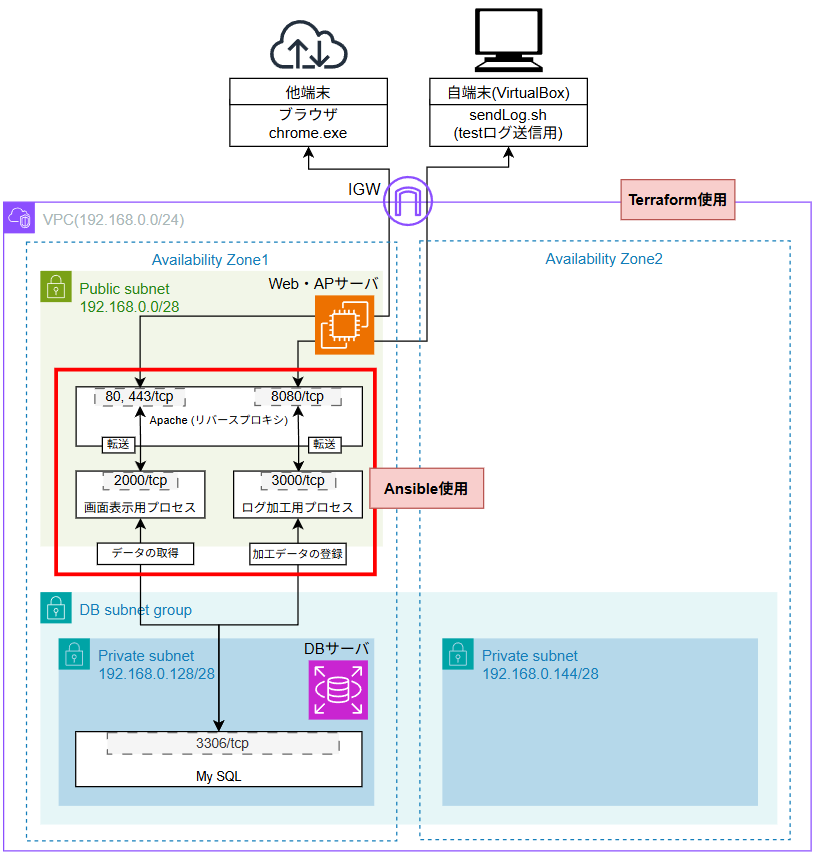

# AWS Infrastructure (Terraform)

AWS上にVPC、サブネット、セキュリティグループ、EC2、RDSなどのインフラストラクチャをモジュール構成で構築するためのTerraformコードです。

## 📁 ディレクトリ構成
```text
.
├── main/                 # ルートモジュール（各リソースやモジュールの呼び出し、変数定義）
│   ├── provider.tf
│   ├── variables.tf
│   ├── terraform.tfvars
│   ├── network.tf
│   ├── security.tf
│   ├── ec2.tf
│   └── rds.tf
└── modules/              # 子モジュール（部品化されたリソース定義）
    ├── network/          # VPC, Subnet など
    ├── security/         # Security Group
    ├── ec2/              # EC2インスタンス
    └── rds/              # RDS (MySQL)
```

## 🚀 構築手順
1. 初期化
```bash
cd ./Terraform_AWS/main/
terraform init
```

2. 実行計画の確認
```bash
terraform plan
```

3. インフラの適用
```bash
terraform apply
```

4. Ansible実行時に必要な情報をファイルとして保存
```bash
terraform output -json > ../../Ansible_AWS/roles/binary/vars/terraform_outputs.json
```

## 🔑 出力値 (Outputs)
適用後、以下の値が参照可能です（Ansibleとの連携時に使用します）。
- RDSのエンドポイント
- DBのパスワード (sensitive = true)
- EC2のIPアドレス 等

## 🌐 アーキテクチャ概要
